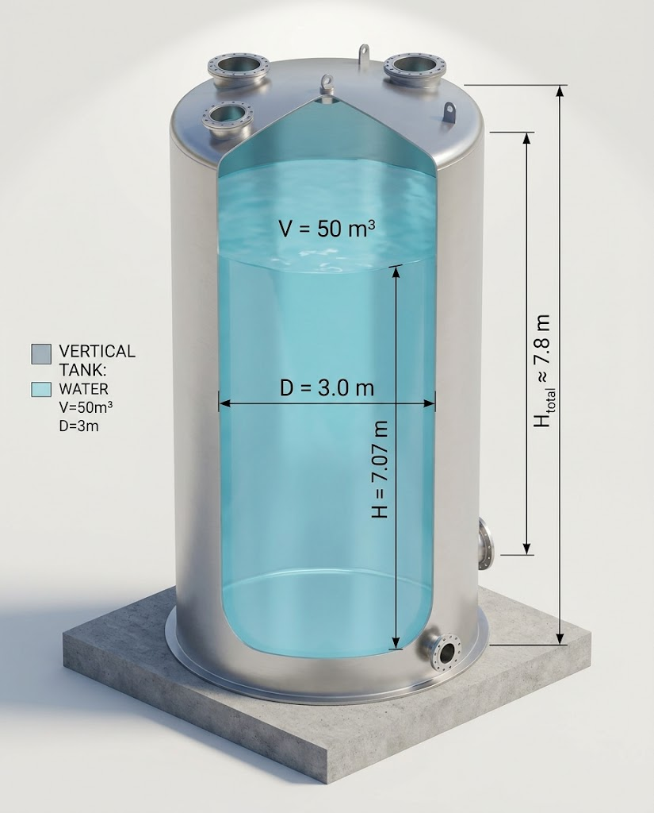
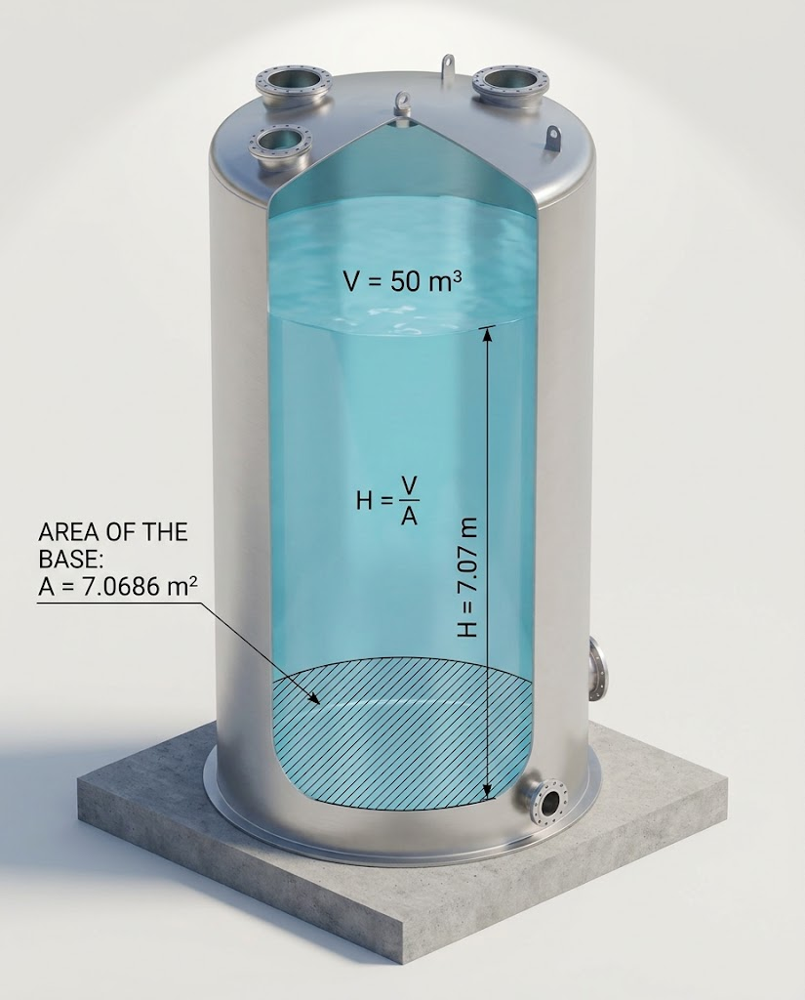
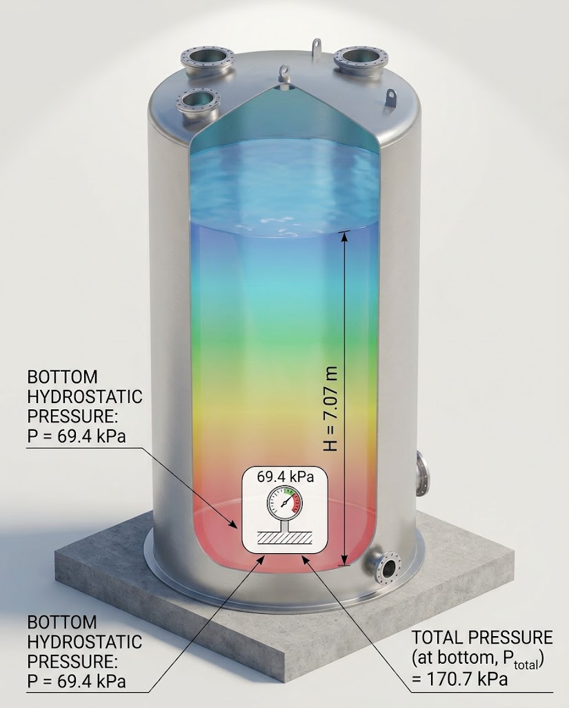
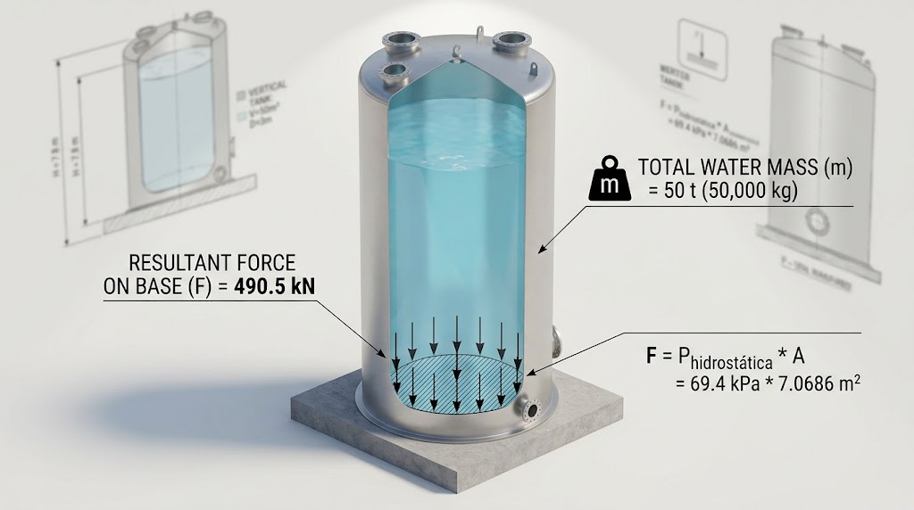

# Vertical Tank Sizing

An agent skill and dependency-free Node.js calculator for preliminary sizing of vertical cylindrical tanks, for one or many sizes. The skill asks the user for the input data first (which two of V, D, H, fluid density, free board, optional shell-thickness check). Main instructions are in English; Portuguese and Spanish translations retain English technical nomenclature.

[English skill](SKILL.md) · [Português](SKILL.pt.md) · [Español](SKILL.es.md)



## Verified example

| Step | Illustration |
|---|---|
| Base area A = 7.0686 m2 and useful height H = V/A = 7.07 m |  |
| Hydrostatic pressure 69.4 kPa, total 170.7 kPa |  |
| Bottom force 490.5 kN and stored mass 50 t |  |

Images were generated with AI and checked against the calculator output (V = 50 m3, D = 3.0 m, water). The executable calculations are the numerical reference.

## What it does

- Computes base area, useful height, total height, hydrostatic and absolute pressure at the base, bottom force and stored mass.
- Accepts V+D, D+H or V+H and a list of tanks in one run.
- Optional shell minimum thickness t = P·D/(2·S·E) + CA at the bottom course.
- Cross-checks F against m·g and warns when H/D is outside 0.5-4.

Verified example: V = 50 m³, D = 3.0 m, water -> H = 7.07 m, P = 69.4 kPa, P_total = 170.7 kPa, F = 490.5 kN, m = 50 t.

## Use

Requires Node.js. No npm dependencies.

```
node scripts/tank-sizing.cjs --self-test
node scripts/tank-sizing.cjs examples/water-50m3.json
node scripts/tank-sizing.cjs examples/multi-size.json
```

For Codex or Claude, copy this repository into your skills directory as `vertical-tank-sizing` and keep SKILL.md, translations, scripts and examples together.

## Scope

Preliminary sizing, not code certification. Minimum thickness per API 650 / ABNT NBR 7821, wind, seismic, roof, vacuum, head geometry, nozzle loads and foundation require separate analysis.

## License

GNU General Public License v3.0 or later. See [LICENSE](LICENSE).
